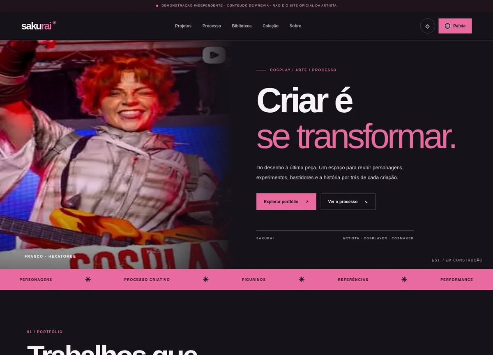
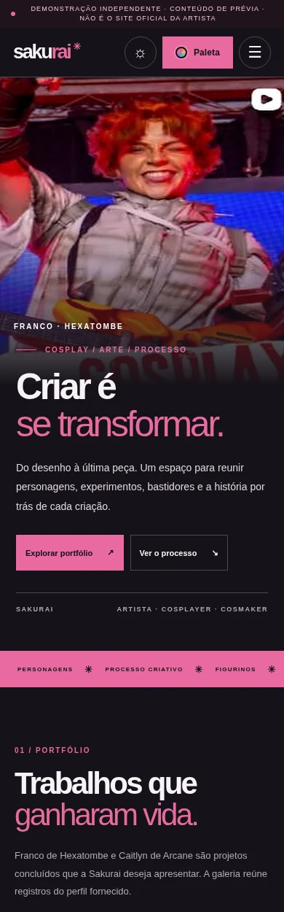
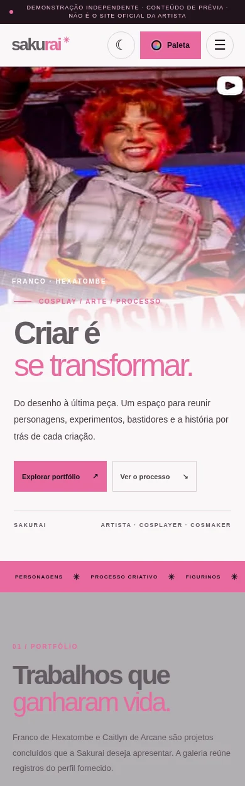
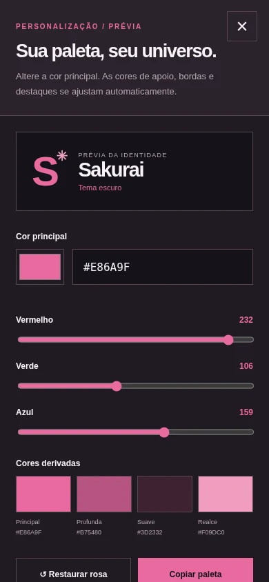

# Sakurai — portfólio editorial interativo · RFB Demo V3

Demonstração **não oficial** e sem orçamento/encomendas, produzida com base nos prints de Instagram apresentados pelo usuário e no feedback direto da artista. Não equivale a contrato, autorização para uso comercial da marca, nem produto oficial.

## O que fazer na demo

1. Abra o site, explore as duas coleções concluídas: **Franco (Hexatombe)** e **Caitlyn (Arcane)**.
2. Filtre o arquivo de 12 imagens, abra detalhes e navegue pelas fotografias.
3. Veja os cartões de projetos **futuros** Coco (Witch Hat Atelier) e Gwayne (A Vigília). Não há alegação de produção iniciada.
4. Explore modelos de **diário de produção**, mini tutoriais, biblioteca de referências com créditos, moldes, buildbooks e ideias de merch. Conteúdos ainda não enviados são explicitamente ilustrativos, sem download, venda nem instruções inventadas.
5. Clique **Paleta**: altere RGB com controles vermelho/verde/azul, campo hexadecimal ou seletor; as cores secundárias mudam com a primária. Clique **Restaurar rosa** para `#E86A9F`. O modo claro/escuro é independente. Personalização permanece no `localStorage` deste navegador e não é publicada no site de terceiros.
6. **Copiar paleta** gera o resumo. **Enviar guia de marca ao desenvolvedor** abre o aplicativo de e-mail (a artista pode anexar arquivos e referências).

## Qualidade das imagens

- As imagens WebP nesta V3 têm ampliação conservadora **660×660** e tratamento de ruído/nitidez a partir de prints do usuário. Na V2 publicada os mesmos arquivos ocupavam 5–20 KB cada; estes WebP melhorados ocupam cerca de 35–127 KB cada. A fonte de 222px **não permite recuperar detalhes fotográficos originais**.
- Não usar estes recortes como versão final de portfólio oficial. Solicitar originais de Sakurai com consentimento explícito e registro de proveniência.
- A imagem de referência Caitlyn é repostada e não atribuída como desenho autoral.
- Foto de terceiros em encontro/evento está apenas na prévia baseada nos prints; revisar autorizações antes de produção.

## Rodar e validar

Arquivos estáticos, sem Firebase ou cobrança: `python -m http.server 8080`. Executar `node --check app.js` e `python tests/smoke.py` (Chromium/Playwright). Script de teste usa `set_content` e imagens embutidas porque a sandbox bloqueia acesso de browser à rede. Para persistência, simula localStorage entre instâncias de página. A verificação de URL pública deve ser separada.

## Isolamento / publicação

Subpasta `demos/sakurai-portfolio-v2/` no repositório `CristianoRFB/cosmaker` via PR isolada. Cloudflare Worker demo isolado; não altera `main`, tenant, credenciais, banco ou a demo V1 de acompanhamento. RFB: checkpoint em `docs/rfb/`, QA produto e visual antes do handoff. Apresentação comercial, custo e contrato são outra conversa.

## Telas da demonstração

| Mobile escuro | Mobile claro | Editor RGB |
|:--:|:--:|:--:|
|  |  |  |

**Prévia Cloudflare:** https://77-sakurai-portfolio-v2.on7.workers.dev/ (Worker atualizado pela API; validação HTTP externa por ferramenta ainda pendente).

## Atualização V4 · vídeo, imagem de origem e créditos
- Foto enviada em alta resolução incluída no hero e na galeria (WebP original + miniatura responsiva).
- Vídeo real de 52,8 s incluído na seção **Vídeo do processo**: tenta reproduzir silenciosamente ao entrar na área visível, pausa ao sair, permite ativar o som e pausar pelos controles nativos; opção de reprodução dedicada e respeito a `prefers-reduced-motion`.
- Créditos em legendas e ficha de referência: criação do cosplay — Sakurai; autoria fotográfica e da gravação — a confirmar; sem autoria falsa para imagem de terceiro.
- Materiais encaminhados pelo usuário para esta demonstração. Antes de divulgar oficialmente, confirmar com a artista as pessoas responsáveis por fotos, vídeos e eventuais trilhas.

## V5 — Movimento contínuo (pedido de 23/11/2026)
- Faixa vertical de fotografias em loop na borda do hero, com segunda sequência duplicada e decorativa para evitar salto.
- Carrossel horizontal infinito antes do contato, com oito imagens reais do acervo da demo, duplicadas para loop contínuo.
- Links sociais Instagram, Linktree e e-mail com botões circulares giratórios, clicáveis e com nomes acessíveis.
- Tipografia em ticker contínuo, hero com zoom sutil, acento giratório e brilho ambiente animado.
- Controle **Pausar movimento** no ticker para desligar os efeitos continuamente animados; estado localStorage. `prefers-reduced-motion: reduce` desativa loops por padrão.
- Sem alteração de imagens, vídeo, paleta personalizável, integrações ou orçamento.
- Testar em 320, 390, 768, 1440px; hover/foco nos botões sociais; verificar pausa e modo reduzido.

## V6 — Molduras por personagem · feedback da Sakurai (25/11/2026)
- Foto de destaque e nome do personagem aparecem em uma moldura editorial, inteiramente clicável.
- Franco e Caitlyn têm páginas próprias e URLs compartilháveis (/projetos/franco e /projetos/caitlyn).
- Franco exibe galeria e vídeo já enviado; Caitlyn mostra registros e referências sem inventar autoria.
- Paleta RGB, rosa original, modo claro/escuro e demais funcionalidades da V5 preservados. Páginas internas herdam as escolhas do navegador.
- QA local: 320, 390, 768 e 1440 px; DOM, links, imagens, responsividade, alternância de tema, zero erros de JS. Validar URLs publicadas separadamente.

## V8 — integridade visual e origem de mídia
- Franco: fotografia real enviada pelo usuário como destaque de portfólio.
- Caitlyn: projeto concluído informado pela artista, fotografias próprias ainda não fornecidas. Card editorial sem atribuir fotos de terceiros à Sakurai.
- Artes dos personagens apenas em seção de referências com origem/autoria a confirmar.
- Foto coletiva do feed rotulada como encontro, sem identificar indevidamente um cosplay como Caitlyn.
- Links dos dois projetos, animações e paleta preservados. Proposta sem encomendas.

## Revisão de identidade visual e atribuição (V9 — 25/11/2026)
- A home usa **fotografia real da Sakurai como Franco**. A moldura de Caitlyn exibe ilustração de referência, com aviso visível de que **não é a cosplayer**.
- A página de Caitlyn abre com a referência da personagem identificada e mantém reservado o espaço para fotografias originais da artista.
- A ilustração de Caitlyn recebida em 25/11 é usada apenas como inspiração, sem confundir arte de terceiros com fotografia ou criação da Sakurai.
- A fotografia de acessórios de outro personagem foi removida da galeria Franco.
- Carrosséis, vídeo, personalizador RGB, tema claro/escuro e páginas individuais preservados. Publicação sempre isolada em PR de demonstração.

## V9 — módulo de exemplo completo de Caitlyn (25/11/2026)

A página `projetos/caitlyn.html` agora é um **buildbook demonstrativo preenchido**: visual de referência da personagem, mapa interativo com cinco pontos selecionáveis, inventário de 14 itens (4 categorias), busca, filtros, fichas modais por peça, ilustração de réplica **cenográfica não funcional**, cinco capítulos fictícios de processo e impressão da ficha. Não há encomendas, preços, cobrança, cadastro ou coleta de dados.

**Proveniência obrigatória:** a Sakurai informou ter concluído Caitlyn, mas não confirmou tecido, material, técnica, fornecedor, autoria de foto ou cronologia. Todos os itens e notas acima são exemplos inventados para avaliar o UX. A imagem é arte de referência do personagem, não fotografia da artista. A peça longa é apenas um prop de fantasia sem mecanismo ou munição. Quando a artista fornecer os dados reais, substituir o conteúdo fictício com aprovação.

**QA:** `node --check caitlyn-demo.js` e `python tests/test_caitlyn_v9.py` (Playwright); teste manual na URL publicada. Visões mobile e desktop; verificar tema, filtros, busca, clique nos pontos, modal, capítulos, impressora e imagens. A homepage continua em `/` e Franco em `/projetos/franco`.
